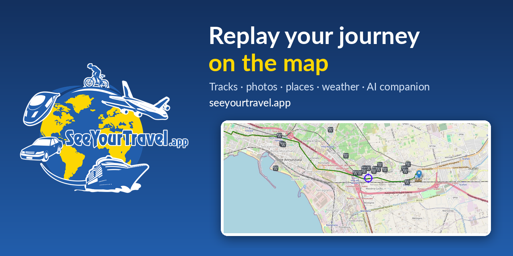
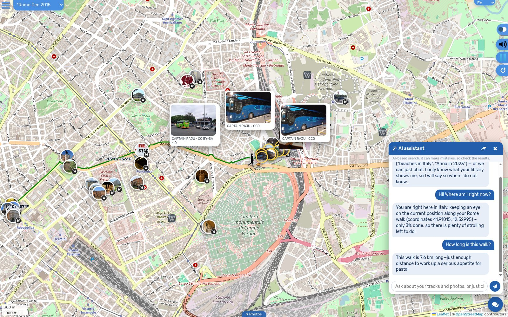
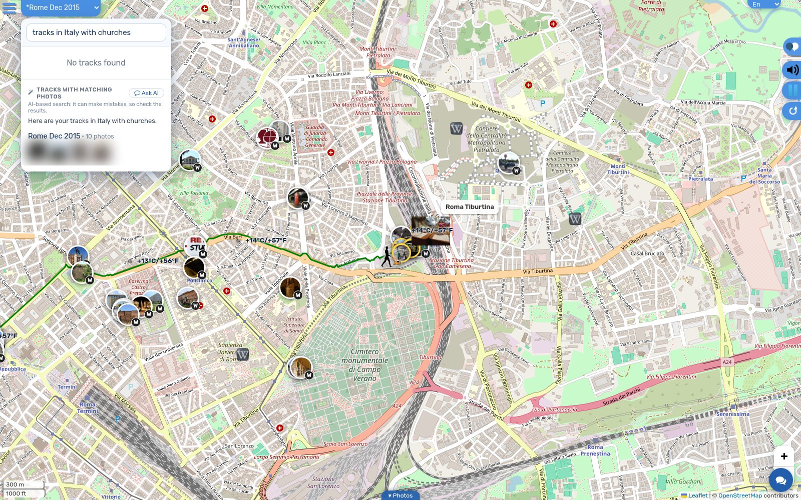
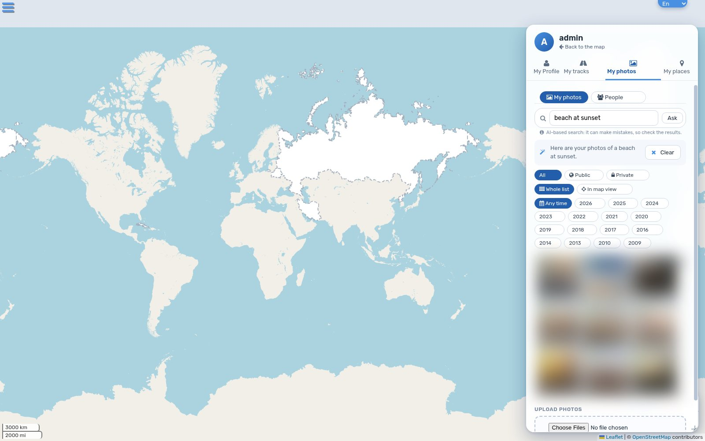
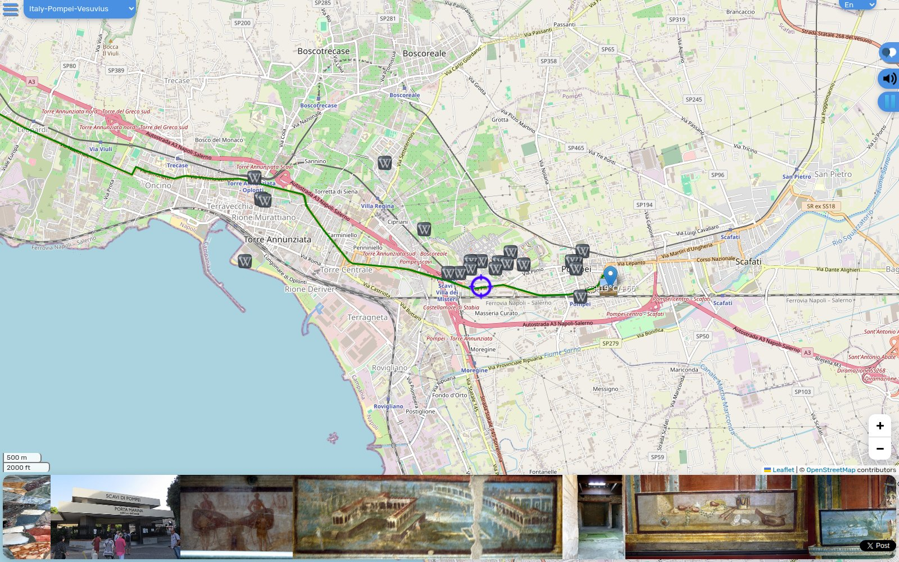
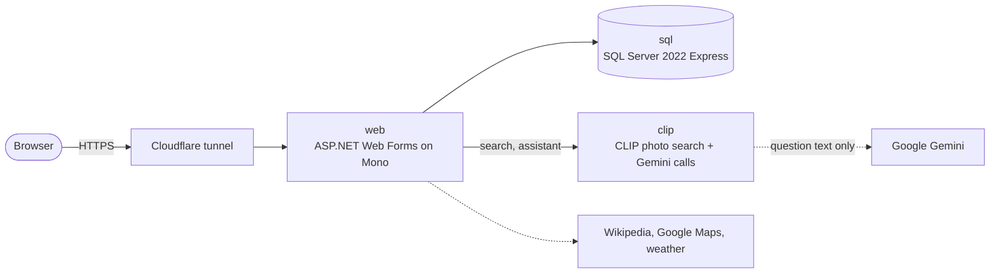

<p align="center">
  <a href="https://seeyourtravel.app"></a>
</p>

<h1 align="center">SeeYourTravel</h1>
<p align="center"><b>Create, share and replay your journeys on a map</b> – with photos, places, weather, elevation and an AI travel companion.</p>

<p align="center">
  <a href="https://seeyourtravel.app"></a>
  <a href="https://github.com/oltur/seeyourtravel/actions/workflows/ci.yml"></a>
  <a href="https://github.com/oltur/seeyourtravel/actions/workflows/security.yml"></a>
  <a href="https://github.com/oltur/seeyourtravel/actions/workflows/images.yml"></a>
  <a href="https://securityscorecards.dev/viewer/?uri=github.com/oltur/seeyourtravel"></a>
  <a href="LICENSE"></a>
  
</p>
<p align="center">
  
  
  
  
  
  
</p>

SeeYourTravel started in 2014 as an ASP.NET Web Forms site and still runs on it, now on Linux (Mono + SQL Server in Docker). Draw or import a route and it is played back on the map, with your photos flying in, places from Wikipedia and Google, weather and the elevation profile along the way.

<table>
  <tr>
    <td width="50%"><br><sub>The assistant knows what is on the screen: the track, elevation, weather, places and photos.</sub></td>
    <td width="50%"><br><sub>Find tracks by a sentence: "tracks in Italy with churches".</sub></td>
  </tr>
  <tr>
    <td><br><sub>Find photos by how they look: "beach at sunset" (private photos are blurred here).</sub></td>
    <td><br><sub>A journey replaying on the map with its photo strip.</sub></td>
  </tr>
</table>

## Contents
[Features](#features) · [How it fits together](#how-it-fits-together) · [Run it](#run-it) · [Configuration](#configuration) · [AI and privacy](#ai-and-privacy) · [Project layout](#project-layout) · [CI and security](#ci-and-security) · [Roadmap](#roadmap) · [Contributing](#contributing) · [License](#license)

## Features
- **Tracks:** draw a route, search two places, import GPX or record your own; replay it with photos, Wikipedia/Google/own places, weather and the elevation profile.
- **Your library:** My tracks, My photos and My places with year, month and person filters, face recognition (local engine) and public/private control per item.
- **AI search and assistant** *(optional, needs a Gemini key)*: find photos by how they look, tracks and places by a sentence ("only the ones near the beach"), and chat with an assistant that sees the screen. It answers in the language you ask in, with voice input and read-aloud.
- **Public journeys:** every public track has its own readable page ([`/track/`](https://seeyourtravel.app/track/)), a sitemap and structured data, so people and search engines can find it.
- **For phones and desktops**, in English, Ukrainian, German and Hebrew.

## How it fits together

Everything is defined in [`compose.yaml`](compose.yaml). The Cloudflare tunnel runs on the host; see [`DEPLOY.md`](DEPLOY.md).

## Run it
```bash
cp web/Web.config.example web/Web.config    # database password, Google client ID, admin accounts
cp .env.example .env                         # SYT_SA_PASSWORD, optional GEMINI_API_KEY
docker network create syt
docker compose up -d                         # or: make up       -> http://localhost:8088
```
The database is **SQL Server 2022 Express**, which is free for production use (10 GB per database; plenty for this app). Do not switch it to the Developer edition on a public site: that edition is licensed for development and testing only. Express cannot compress backups, so `tools/db_backup.sh` writes plain `.bak` files.

Without a Google client ID the site runs in *local mode*: you are signed in as the owner. This mode is never used for requests that come through a proxy or tunnel.
Other commands: `docker compose --profile test up -d web-test` (test copy on :8089), `docker compose run --rm clip-index` (build the photo search index), and the targets in the [`Makefile`](Makefile).

## Configuration
| Where | Name | What it does |
|-------|------|--------------|
| `.env` | `SYT_SA_PASSWORD` | SQL Server administrator password |
| `.env` | `GEMINI_API_KEY` | enables the AI assistant (optional; without it search falls back to plain words) |
| `.env` | `ASSIST_DAILY_USER`, `ASSIST_DAILY_ALL`, `ASSIST_MONTHLY_USD` | usage limits of the assistant (150 / 300 / 2 by default) |
| `.env` | `PORT` | local port of the site (8088) |
| `web/Web.config` | `GoogleClientId`, `GoogleAdmins` | Google sign-in and the administrator accounts |
| `web/Web.config` | connection strings | the database login of the application |

`.env` and `web/Web.config` are git-ignored: never commit them.

## AI and privacy
- The photo search runs **on your own machine** (CLIP models in the `clip` container). No photo ever leaves it.
- The assistant sends only the text of your question and a short description of what is on the screen to Google Gemini, with daily and monthly limits that stop the spending.
- Private tracks and photos are never shown to other visitors; public pages show public content only.

## Project layout
| Path | What |
|------|------|
| `web/` | the website: pages (`*.aspx`), services (`services/`), scripts (`js/`), styles, translations (`locales/`), C# helpers (`App_Code/`) |
| `tools/` | imports, backups, face scan, photo search index (`tools/clip`), IndexNow |
| `compose.yaml`, `Makefile`, `Dockerfile.web` | how it runs |
| `.github/` | CI, security checks, Dependabot, templates |

## CI and security
Every push and pull request is checked by GitHub Actions: lint (compose, shell, Python, JSON and translations), a build of the website image with a start-up check, a secret scan over the whole history (gitleaks), Trivy (dependencies, secrets, Dockerfile settings) and CodeQL (JavaScript, Python). Docker images are built and scanned weekly, Dependabot proposes updates, and an [OpenSSF Scorecard](https://securityscorecards.dev/viewer/?uri=github.com/oltur/seeyourtravel) rates the practices. To report a vulnerability, see [SECURITY.md](SECURITY.md).

## Roadmap
- Upgrade Newtonsoft.Json (needs a binding redirect in `web/Web.config`) and run the containers as a non-root user.
- Public photos on the public track pages.
- More languages.

## Contributing
Issues and pull requests are welcome: see [CONTRIBUTING.md](CONTRIBUTING.md) and the [code of conduct](CODE_OF_CONDUCT.md).

## License
The code is released under the [MIT License](LICENSE). Libraries, map data, images and AI models keep their own licences: see [THIRD_PARTY_NOTICES.md](THIRD_PARTY_NOTICES.md). Map tiles © OpenStreetMap contributors.
